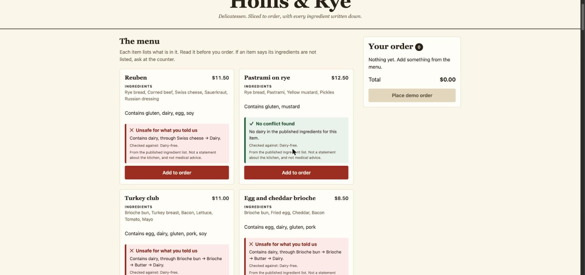

# Vouch

**A deli website whose assistant may describe the food, rank it, and talk about it — but may
never tell you it is safe to eat.**

A deterministic checker owns every safety verdict. The model proposes, a gate decides, and the
evidence survives. That is not a prompt instruction; it is enforced by the type system, and
rendering a model-supplied verdict does not compile.

- **Live:** <https://vouch-deli.netlify.app>
- **The peer site it composes with:** <https://marrow-point-bakery.netlify.app>
- **Demo video:** <https://www.youtube.com/watch?v=7CxnNG95PgM>

Built for the [Open Agentic Web Challenge](https://cognizant-agenticweb.devpost.com/) against the
MVP profile pinned at [`docs/mvp-spec-2026-11-23.md`](docs/mvp-spec-2026-11-23.md).



## The idea, in one example

Tick **Dairy-free** and the Turkey club comes back:

> **✕ Unsafe for what you told us**
> Contains dairy, through Brioche bun → Brioche → Butter → Dairy.
> *Checked against: Dairy-free.*
> *From the published ingredient list. Not a statement about the kitchen, and not medical advice.*

Butter, three steps down a derivation chain, inside a bun — invisible in the ingredient line a
person would actually read. No model produced that verdict and none could change it.

Three things follow from the design:

- **There is no `safe`.** A clear dish reads *"No conflict found"*. Where the data is silent the
  answer is *"We don't know"* — never a guess in the guest's favour.
- **The gate withholds true statements too.** A model correctly saying *"this is not dairy-free"*
  is refused exactly like one saying it is. That cost is real and survivable only because the
  verdict is rendered **beside** the prose, never through it.
- **It works with no model at all.** The menu, the ingredient data and every verdict run with
  JavaScript off and no API key. The assistant is additive.

## The part that is useful to other people

[`tools/conformance`](tools/conformance) is a dependency-light CLI that checks **any** agentic
site against the spec — not just this one:

```bash
node tools/conformance/cli.ts https://your-site.example/agents/your_network
```

It reports twenty checks in every run and **tells you which six it did not make**, because
*"I did not look"*, *"I looked and it is wrong"* and *"this cannot be checked from here"* are
three different statements. A conformance tool that implies coverage it does not have is the same
failure this whole project is about.

Against the two sites above it scores 14 of 14 machine-checkable checks, exit 0. Apache-2.0, no
runtime dependencies, copy the directory and run it.

## Worth reading, if you only read two files

- **[`docs/LIMITS.md`](docs/LIMITS.md)** — what this build does *not* do. Residual leaks in the
  gate and which of its two defences is the weaker one; the allergens outside the tracked set;
  where a private-context claim would be overstated. It is long on purpose.
- **[`docs/DECISIONS.md`](docs/DECISIONS.md)** — the rulings that shaped the product, *and the
  mistakes*, including a consent card that once said "This reads only." about running a
  stranger's code, and the test that passed while it did.

A project arguing that systems should say plainly what they do not know would be a poor
advertisement for itself if its own record were tidied.

## Running it

Node 22.18+.

```bash
npm install
npm test          # 521 tests
npm run build     # the deli  -> dist/
npm run build:peer # the bakery -> peer-dist/
```

Static hosting, browser execution, visitor-supplied inference. No server-side code, and the site
ships no API key and pays for no inference.

## Licence and provenance

Apache-2.0 ([`LICENSE`](LICENSE), [`NOTICE`](NOTICE)). Parts of the runtime are adapted from
Cognizant AI Lab's Neuro SAN and nsDeploy, also Apache-2.0; exactly which files, from where, and
what changed is recorded in [`docs/vendor/PROVENANCE.md`](docs/vendor/PROVENANCE.md) so that
"which parts are yours?" has a one-file answer.
